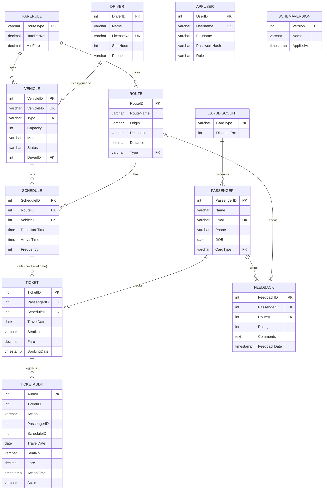

# TransitIQ — Smart Public Transport Management System

A secure, role-based web application for managing urban transit: routes, schedules, fleet, drivers,
passengers, ticket booking and feedback. The MySQL database does the heavy lifting — constraints,
views, functions, stored procedures with transactions and a cursor, triggers, data-driven fares,
schema migrations and least-privilege database users — and Flask provides the interface.

## Tech stack
- **Frontend:** HTML5, Bootstrap 5, Bootstrap Icons, Chart.js
- **Backend:** Python 3, Flask, `mysql-connector-python`, `waitress` (production-style server)
- **Database:** MySQL 8+ (views, functions, procedures, triggers, CHECK constraints, indexes, privileges, versioned schema)

## Features
| Page | What it does |
|---|---|
| **Login / My account** | Session login, salted password hashes, three roles, sign-in attempt limit, change your own password |
| **Dashboard** | KPIs, revenue-by-route chart, busiest trips, recent bookings |
| **Bookings** | Book a seat **on a travel date** via `BookTicket` (fare from `CalcFare`, free seats shown for the chosen trip), **transfer** a ticket (another departure, seat or day) via `TransferTicket` in one transaction, cancel via `CancelTicket`, server-side search and pagination, CSV export |
| **Passengers** | Add / edit / delete, trips and spend per passenger, search and pagination |
| **Fleet & Drivers** | Vehicles and drivers CRUD, vehicle status (Active / Maintenance / Retired) |
| **Routes & Schedules** | Routes and schedules CRUD, occupancy today, no overlapping runs and no wrong vehicle type for a route, **editable fare rules and card discounts** (admin) |
| **Feedback** | Ratings per route, average rating per route |
| **Reports** | 12 SQL reports — joins, GROUP BY/HAVING, subquery, anti-join, window functions, CTE, recursive CTE, a cursor procedure — with the query shown; short lists and a 30-second cache keep them fast on large data |
| **Users** *(admin)* | Create and remove application users |

### Roles
| Role | Can do |
|---|---|
| `viewer` | Read everything (dashboard, reports, lists). Can sign out and change own password. |
| `staff` | Everything a viewer can, plus bookings / transfers / cancellations, add & edit passengers, add feedback |
| `admin` | Everything, including fleet, routes, schedules, fare rules, deletes and user management |

Permissions are enforced **on the server** for every request; hidden buttons are only a convenience.
Demo accounts are created automatically on first start: `admin / admin123`, `staff / staff123`,
`viewer / viewer123`. **Change these (My account, or the Users page) before any real deployment.**

### Security
- Passwords hashed with Werkzeug (salted), never stored in plain text; minimum length 8; 5 failed sign-ins lock a username/address pair for 10 minutes
- CSRF token required on every POST; HttpOnly + SameSite session cookies; private pages are not cached
- All SQL uses parameterised queries; templates auto-escape output; CSV export neutralises spreadsheet formulas
- **The application connects as a least-privilege database user (`transitiq_app`), not root.** It cannot create,
  alter or drop anything, and it can only *read* the audit table — only the triggers write to it
- The audit trail records **who** acted: the application tells MySQL the signed-in user for each connection
- The database password lives in a git-ignored `.env` file (`scripts/set_app_password.sh` changes it); debug mode is off by default

## Database design


### Database objects
| Type | Name | Purpose |
|---|---|---|
| Tables | 12 (see the diagram) | Reference data (`FareRule`, `CardDiscount`), transport data, `Ticket` per **trip** (schedule + travel date), `TicketAudit`, `AppUser`, `SchemaVersion` |
| Views | `BookingSummary`, `ScheduleOccupancy` (today), `TripOccupancy` (any date), `RouteRevenue`, `RouteRatings`, `ActiveVehicle` | Dashboard and reporting; `ActiveVehicle` is updatable `WITH CHECK OPTION` |
| Functions | `SeatsLeft(schedule, date)`, `CalcFare(passenger, schedule)` | Free seats of a trip; fare = max(MinFare, distance × RatePerKm) minus the card discount, **read from the `FareRule` and `CardDiscount` tables** |
| Procedures | `BookTicket`, `CancelTicket`, `TransferTicket`, `RouteScorecard` | Booking (date rules: not in the past, at most 30 days ahead) and cancellation; **transfer as one all-or-nothing transaction** (`START TRANSACTION`, exit handler, `ROLLBACK`); **cursor** that scores and grades every route |
| Triggers | `PreventDoubleSeat`, `CheckCapacity`, `PreventVehicleOverlap`, `CheckVehicleRouteType`, `AuditBooking`, `AuditCancellation` | Reject a taken seat / full or out-of-service vehicle (per trip) / overlapping runs / a vehicle on a route of the wrong type; write the audit trail with the actor. `PreventDoubleSeat` also locks the departure so simultaneous bookings queue instead of deadlocking |
| Constraints | `UNIQUE (ScheduleID, TravelDate, SeatNo)`, `CHECK` on fare, seat label, travel date window, capacity, rating, times, status, role; foreign keys to the reference tables | Integrity enforced inside the database |
| Indexes | `Ticket.PassengerID`, `Ticket.TravelDate`, `Schedule.RouteID`, `Schedule.VehicleID`, `Feedback.RouteID`, plus the unique trip-seat key | Faster joins — measured on 200,000 rows (see below) |
| Privileges | user `transitiq_app` | Read/write business tables, update fare rules, **read-only audit table**, execute routines, nothing else |

### Normalisation: every relation is in BCNF
Each non-trivial functional dependency has a candidate key on its left side:

| Relation | Functional dependencies (candidate keys on the left) |
|---|---|
| FareRule | RouteType → all |
| CardDiscount | CardType → all |
| Passenger | PassengerID → all; Email → all |
| Driver | DriverID → all; LicenseNo → all |
| Route | RouteID → all |
| Vehicle | VehicleID → all; VehicleNo → all |
| Schedule | ScheduleID → all; (VehicleID, DepartureTime) → all |
| Ticket | TicketID → all; (ScheduleID, TravelDate, SeatNo) → all |
| Feedback | FeedbackID → all |
| AppUser | UserID → all; Username → all |

`Ticket.Fare` is stored on purpose although `CalcFare` can compute it: the price paid must not change when the
fare rules change later. `TicketAudit` is a deliberate denormalised history log.

### Transactions, isolation and locking
- The default isolation level is REPEATABLE READ (InnoDB). `scripts/isolation_demo.py` shows what each level does with
  two real sessions: READ COMMITTED lets a re-read change (10 then 200) and lets a phantom row appear, REPEATABLE READ keeps a
  stable snapshot; a read-then-write update **loses** one of two concurrent updates (11 instead of 12), while
  `SELECT … FOR UPDATE` or a single `UPDATE x = x + 1` gets it right.
- Booking would still allow two sessions to read the same seat count, so `PreventDoubleSeat` starts with
  `SELECT … FOR UPDATE` on the departure row: bookings for one departure are **serialised** while other departures proceed in
  parallel. 20 simultaneous bookings on a 5-seat vehicle store exactly 5 tickets and answer the other 15 with “Vehicle is full”.
- `TransferTicket` is a multi-statement transaction: if any step raises an error the handler issues `ROLLBACK`
  and re-raises, so a passenger never ends up with no ticket or with two. Twelve transfers in opposite directions at the same
  moment lose and duplicate nothing (tested).

## Setup
1. Start MySQL 8+, then import the schema as the MySQL admin (safe to re-run). It also creates the restricted
   application user `transitiq_app`:
   ```bash
   mysql -u root -p < schema.sql
   ```
   (or open `schema.sql` in MySQL Workbench and run it). **Upgrading an older database instead?** Use the migration runner
   below — it keeps your data.
2. Install dependencies:
   ```bash
   python3 -m venv .venv && source .venv/bin/activate
   pip install -r requirements.txt
   ```
3. Run and open <http://127.0.0.1:5000> — the production-style server:
   ```bash
   python -m waitress --listen=127.0.0.1:5000 app:app
   ```
   or the development server (auto-reload with `FLASK_DEBUG=1`): `python app.py`.
   The app logs in to MySQL as `transitiq_app`. Settings come from the environment or a git-ignored `.env` file
   (see `.env.example`): `DB_USER`, `DB_PASSWORD`, `DB_HOST`, `DB_NAME`, `SECRET_KEY`, `REPORT_CACHE_SECONDS`.
4. Replace the demo database password before any real use:
   ```bash
   scripts/set_app_password.sh 'a-long-new-password'
   ```

`queries.sql` contains the 12 report queries so they can be run directly in MySQL Workbench.

## Operations
| Task | Command |
|---|---|
| Upgrade an existing database to the latest schema (backup first, data kept) | `python scripts/migrate.py` (`--status` to look only) |
| Back up (data, views, routines, triggers) | `scripts/backup.sh [file]` → `backups/public_transport_<timestamp>.sql` |
| Restore into any database | `scripts/restore.sh file [target-database]` |
| Load a large demo data set (≈ 3,000 passengers, 25,000 tickets) | `python scripts/load_sample_data.py` (safe to re-run; `--scale 0.1` for a smaller set) |
| Index benchmark on 200,000 tickets | `python scripts/benchmark.py` → `benchmarks/results.json` |
| Time every report (use on large data) | `DB_NAME=… python scripts/report_timings.py` |
| See isolation levels and locking in action | `python scripts/isolation_demo.py` |
| Change the application's database password | `scripts/set_app_password.sh 'new-password'` |

Admin tools use `MYSQL_ADMIN_USER` / `MYSQL_ADMIN_PASSWORD` (default: `root`, empty password).

### Schema versions and migrations
A database records its version in `SchemaVersion`. `schema.sql` is always the latest version (a fresh install); files in
`migrations/` upgrade older databases step by step. `migrations/0002_*.sql` is generated by `migrations/make_0002.py`: its
structural part is hand-written, and every programmable object (views, functions, procedures, triggers, grants) is copied
verbatim from `schema.sql`. A test upgrades a version-1 database and compares **179 schema facts** (columns, indexes, checks,
foreign keys, triggers, routines, views) with a fresh install — they are identical, and existing tickets keep their data.

### Large sample data and pagination
`schema.sql` seeds a small, readable demo (13 passengers, 24 tickets for today). To see the system at a realistic size, run the loader:

```bash
python scripts/load_sample_data.py
```

It adds 30 routes, 66 vehicles and drivers, about 600 departures, about 3,000 passengers, about 25,000 tickets (each departure
runs on two different days of the last month) and about 1,500 feedback entries in a few seconds. Every row goes through the
application's own database user, so it passes the same constraints and triggers as real use: no overbooked trip, no duplicate
seat, no overlapping run, and every ticket has an audit row. Running it twice does nothing.

Long lists would be unusable at that size, so the application searches and pages on the server. Measured on the loaded data
(about 25,000 tickets):

| Page | Without search/pagination | With it |
|---|---|---|
| Bookings | 26 MB page, 24,812 table rows, 654 ms | **≈ 320 KB, 50 rows, ≈ 70 ms** |
| Passengers | 3.4 MB, 3,014 rows | **65 KB, 50 rows, ≈ 8 ms** |
| Reports (12 queries) | 747 KB, 6,433 rows, ≈ 330 ms | **30 KB, 126 rows, ≈ 270 ms first view, ≈ 3 ms cached** |

At 4× the data (about 104,000 tickets) all twelve reports together take about 1.1 s; they scale roughly linearly.

### Index benchmark (200,000 tickets, separate database)
Measured by `scripts/benchmark.py` (mean of 15 runs; numbers vary a little per machine):

| Query | With index | Without | Speed-up | Plan with → without |
|---|---|---|---|---|
| Passenger history `WHERE PassengerID = ?` | 0.17 ms | 18.9 ms | ≈ 111× | `ref` on `idx_ticket_passenger` → full scan `ALL` |
| Seat lookup `WHERE ScheduleID = ? AND TravelDate = ? AND SeatNo = ?` | 0.12 ms | 3.9 ms | ≈ 32× | `const` on `uq_trip_seat` → falls back to the date index (`ref`) |
| Passenger spend per route (3-table join) | 0.35 ms | 24.9 ms | ≈ 71× | index nested-loop join → scan of the big table |

## Tests
75 end-to-end tests: authentication, roles, CSRF, **trips and travel dates, fare rules, type checks, who-acted audit**, booking
rules, triggers, fare calculation, CRUD, constraints, reports, **transactions and rollback, concurrent transfers, isolation
levels, database privileges, the updatable view, window/CTE/cursor reports, backup and restore round trip, schema
migration equivalence**, account security (password change, sign-in limit), the production server, the large-data loader with
search and pagination, regression tests for concurrency / overlapping schedules / CSV safety / validation, and a UI audit that
presses every visible button as every role. They build throw-away databases from `schema.sql` and drop them afterwards — your
real data is never touched.
```bash
python -m unittest discover -s tests -v
```
(Set `MYSQL_ADMIN_USER` / `MYSQL_ADMIN_PASSWORD` if the admin account is not `root` with an empty password.)

## Project structure
```
app.py          Flask routes, auth, database helpers, report definitions
schema.sql      the latest schema: tables, constraints, indexes, views, functions, procedures, triggers, privileges, seed data
migrations/     upgrade scripts for older databases, the version-1 baseline used by the migration test
queries.sql     the 12 report queries, runnable in MySQL Workbench
scripts/        migrate, backup, restore, load_sample_data, benchmark, report_timings, isolation_demo, set_app_password
benchmarks/     results.json (output of the last benchmark run)
tests/          automated test suite
templates/      Jinja2 pages (base layout + one template per page)
static/         style.css, app.js
```

## Known limits
- Seats are validated as labels (1–6 letters or digits) and counted against the vehicle's capacity; there is no seat map.
- A schedule is a recurring departure time; calendars of service days (holidays, weekdays only) are not modelled.
- No payment step, no real-time tracking, no replication or failover (single MySQL server).
