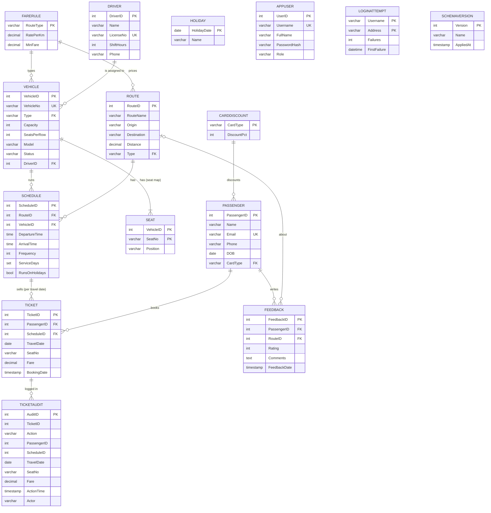

# RouteWise — Public Transport Management System

[](https://github.com/sarveshsuhaskute/RouteWise/actions/workflows/tests.yml)

A secure, role-based web application for running a city's buses and metro: routes, timetables with service days and
public holidays, fleet with a seat map per vehicle, drivers, passengers, seat-by-seat ticket booking and feedback.
The MySQL database does the heavy lifting — constraints, views, functions, stored procedures with transactions and a cursor,
ten triggers, a scheduled event, FULLTEXT search, data-driven fares, versioned migrations and least-privilege database
users — and Flask provides the interface.

## Tech stack
- **Frontend:** HTML5, Bootstrap 5, Bootstrap Icons, Chart.js, a small vanilla-JS seat picker
- **Backend:** Python 3, Flask, `mysql-connector-python`, `waitress` (production-style server)
- **Database:** MySQL 8+ (views, functions, procedures, triggers, events, CHECK constraints, B-tree and FULLTEXT indexes, privileges, versioned schema)
- **CI:** GitHub Actions runs the whole test suite against a real MySQL server on every push

## Features
| Page | What it does |
|---|---|
| **Login / My account** | Session login, salted password hashes, three roles, a sign-in attempt limit stored in the database, own-password change, a warning while a published demo password is in use |
| **Dashboard** | KPIs, departures running today, the next public holiday, revenue-by-route chart, busiest trips, recent bookings |
| **Bookings** | Pick a seat on the **seat map** of the chosen trip (window / aisle / middle, taken seats greyed out), book via `BookTicket`, **transfer** to another departure, seat or day via `TransferTicket` in one transaction, cancel via `CancelTicket`, indexed search, pagination, CSV export |
| **Passengers** | Add / edit / delete, trips and spend per passenger, FULLTEXT search by name or email, phone and number lookup |
| **Fleet & Drivers** | Vehicles (capacity and **seats per row**, which define the seat map) and drivers, vehicle status (Active / Maintenance / Retired) |
| **Routes & Schedules** | Routes, departures with their **service days** (e.g. Mon–Fri) and whether they run on public holidays, a **public-holiday calendar**, occupancy today, editable fare rules and card discounts (admin) |
| **Feedback** | Ratings per route, average rating per route |
| **Reports** | 13 SQL reports — joins, GROUP BY/HAVING, subquery, anti-join, window functions, CTE, recursive CTE, a cursor procedure, a composite-key join into the seat map — each with its query shown; short lists and a 30-second cache keep them fast on large data |
| **Users** *(admin)* | Create and remove application users |

### Roles
| Role | Can do |
|---|---|
| `viewer` | Read everything (dashboard, reports, lists). Can sign out and change own password. |
| `staff` | Everything a viewer can, plus bookings / transfers / cancellations, add & edit passengers, add feedback |
| `admin` | Everything, including fleet, routes, schedules, holidays, fare rules, deletes and user management |

Permissions are enforced **on the server** for every request; hidden buttons are only a convenience.

### Security
- Passwords hashed with Werkzeug (salted), never stored in plain text; minimum length 8; the published demo passwords cannot be chosen again
- **Five failed sign-ins lock a username/address pair for 10 minutes.** The count lives in the `LoginAttempt` table, so a
  restart does not reset it and every server process sees the same count; a MySQL **event** deletes day-old entries every hour
- Demo accounts (`admin / admin123`, `staff / staff123`, `viewer / viewer123`) exist only for a demonstration: the app shows a
  warning banner to anyone signed in with one of those passwords. With `DEMO_USERS=0` they are never created; create the
  first administrator with `python scripts/create_admin.py <username>` instead
- CSRF token required on every POST; HttpOnly + SameSite session cookies; private pages are not cached
- All SQL uses parameterised queries (search terms included: FULLTEXT operators typed by a user are stripped); templates auto-escape output; CSV export neutralises spreadsheet formulas
- **The application connects as a least-privilege database user (`routewise_app`), not root.** It cannot create, alter
  or drop anything, and it can only *read* the audit table and the seat map — only triggers write to those
- The audit trail records **who** acted: the application tells MySQL the signed-in user for each connection
- The database password and `SECRET_KEY` live in a git-ignored `.env` file (`scripts/set_app_password.sh` changes the password); debug mode is off by default

## Database design

`HOLIDAY` is read by the `RunsOn` function rather than referenced by a key; `LOGINATTEMPT` and `SCHEMAVERSION` stand alone.

### Database objects
| Type | Name | Purpose |
|---|---|---|
| Tables | 15 (see the diagram) | Reference data (`FareRule`, `CardDiscount`, `Holiday`), transport data, the seat map (`Seat`), `Ticket` per **trip** (schedule + travel date), `TicketAudit`, `AppUser`, `LoginAttempt`, `SchemaVersion` |
| Views | `BookingSummary`, `ScheduleOccupancy` (today, incl. whether it runs today), `TripOccupancy` (any date), `RouteRevenue`, `RouteRatings`, `ActiveVehicle` | Dashboard and reporting; `ActiveVehicle` is updatable `WITH CHECK OPTION` |
| Functions | `SeatsLeft(schedule, date)`, `CalcFare(passenger, schedule)`, `RunsOn(schedule, date)` | Free seats of a trip; fare = max(MinFare, distance × RatePerKm) minus the card discount, **read from tables**; whether a departure runs on a date (service days and holidays) |
| Procedures | `BookTicket`, `CancelTicket`, `TransferTicket`, `RouteScorecard`, `GenerateSeats` | Booking with date rules (not in the past, at most 30 days ahead); **transfer as one all-or-nothing transaction** (`START TRANSACTION`, exit handler, `ROLLBACK`); a **cursor** that scores and grades every route; seat-map generation with a recursive CTE |
| Triggers (10) | `PreventDoubleSeat` → `CheckServiceDay` → `CheckCapacity` → `ValidateSeat` on Ticket (ordered with `FOLLOWS`); `PreventVehicleOverlap`, `CheckVehicleRouteType` on Schedule; `AuditBooking`, `AuditCancellation`; `CreateSeats`, `ResizeSeats` on Vehicle | Reject a taken seat, a day the departure does not run, a full or out-of-service vehicle, a seat the vehicle does not have, overlapping runs, a vehicle on a route of the wrong type; write the audit trail with the actor; keep the seat map in step with the vehicle and refuse a change that would remove a seat booked for an upcoming trip |
| Event | `PurgeLoginAttempts` (every hour) | Deletes sign-in failures older than a day, inside MySQL |
| Constraints | 17 `CHECK` (fare, seat label, travel-date window, capacity, seats per row, seat position, service days, rating, times, status, role ...), 11 foreign keys, `UNIQUE (ScheduleID, TravelDate, SeatNo)` | Integrity enforced inside the database |
| Indexes | B-tree: `Ticket.PassengerID`, `Ticket.TravelDate`, `Schedule.RouteID`, `Schedule.VehicleID`, `Feedback.RouteID`, `Passenger.Phone`, the unique trip-seat key; **FULLTEXT:** `Passenger(Name, Email)`, `Route(RouteName, Origin, Destination)` | Faster joins and search — measured on 200,000 rows (see below) |
| Privileges | user `routewise_app` | Read/write business tables, update fare rules, manage holidays, **read-only audit table and seat map**, execute routines, nothing else |

### Normalisation: every relation is in BCNF
Each non-trivial functional dependency has a candidate key on its left side:

| Relation | Functional dependencies (candidate keys on the left) |
|---|---|
| FareRule | RouteType → all |
| CardDiscount | CardType → all |
| Passenger | PassengerID → all; Email → all |
| Driver | DriverID → all; LicenseNo → all |
| Route | RouteID → all |
| Vehicle | VehicleID → all; VehicleNo → all |
| Seat | (VehicleID, SeatNo) → Position (window/aisle depends on the vehicle's layout, so the whole key is needed) |
| Schedule | ScheduleID → all; (VehicleID, DepartureTime) → all |
| Holiday | HolidayDate → Name |
| Ticket | TicketID → all; (ScheduleID, TravelDate, SeatNo) → all |
| Feedback | FeedbackID → all |
| AppUser | UserID → all; Username → all |
| LoginAttempt | (Username, Address) → all |

Two deliberate exceptions, both maintained by the database itself: `Ticket.Fare` is stored although `CalcFare` can compute it
(the price paid must not change when the fare rules change later), and the `Seat` rows follow from `Vehicle.Capacity` and
`SeatsPerRow` (the triggers rebuild them on every change, and a seat needs a row of its own so a ticket can be checked against
it and the report can join on it). Row and column are not stored separately in `Seat`: they are part of the label (`7C`),
which would otherwise break BCNF. `TicketAudit` is a history log.

### Transactions, isolation and locking
- The default isolation level is REPEATABLE READ (InnoDB). `scripts/isolation_demo.py` shows what each level does with
  two real sessions: READ COMMITTED lets a re-read change (10 then 200) and lets a phantom row appear, REPEATABLE READ keeps a
  stable snapshot; a read-then-write update **loses** one of two concurrent updates (11 instead of 12), while
  `SELECT … FOR UPDATE` or a single `UPDATE x = x + 1` gets it right.
- `PreventDoubleSeat` starts with `SELECT … FOR UPDATE` on the departure row: bookings for one departure are **serialised**
  while other departures proceed in parallel. Twenty sessions fighting for the five seats of one vehicle store exactly five
  tickets, and the other fifteen get "Seat already booked" or "Vehicle is full" — never a deadlock or an oversold trip.
- `TransferTicket` is a multi-statement transaction: if any step raises an error the handler issues `ROLLBACK`
  and re-raises, so a passenger never ends up with no ticket or with two. Twelve transfers in opposite directions at the same
  moment lose and duplicate nothing (tested).
- The sign-in limit uses a single `INSERT … ON DUPLICATE KEY UPDATE`, so two failed attempts at the same moment cannot overwrite each other's count.

## Setup
1. Start MySQL 8+, then import the schema as the MySQL admin (safe to re-run). It also creates the restricted
   application user `routewise_app`:
   ```bash
   mysql -u root -p < schema.sql
   ```
   (or open `schema.sql` in MySQL Workbench and run it). **Upgrading an older database instead?** Use the migration runner
   below — it keeps your data.
2. Install dependencies:
   ```bash
   python3 -m venv .venv && source .venv/bin/activate
   pip install -r requirements.txt
   ```
3. Run and open <http://127.0.0.1:5000> — the production-style server:
   ```bash
   python -m waitress --listen=127.0.0.1:5000 app:app
   ```
   or the development server (auto-reload with `FLASK_DEBUG=1`): `python app.py`.
   On macOS use `127.0.0.1`, not `localhost`: AirPlay Receiver also listens on port 5000.
   Settings come from the environment or a git-ignored `.env` file (see `.env.example`): `DB_USER`, `DB_PASSWORD`,
   `DB_HOST`, `DB_NAME`, `SECRET_KEY` (keeps people signed in across restarts), `DEMO_USERS`, `REPORT_CACHE_SECONDS`.
4. Before any real use: replace the database password and do not use the demo accounts.
   ```bash
   scripts/set_app_password.sh 'a-long-new-password'
   ```

`queries.sql` contains the 13 report queries so they can be run directly in MySQL Workbench.

## Operations
| Task | Command |
|---|---|
| Upgrade an existing database to the latest schema (backup first, data kept) | `python scripts/migrate.py` (`--status` to look only) |
| Back up (data, views, routines, triggers, events) | `scripts/backup.sh [file]` → `backups/public_transport_<timestamp>.sql` |
| Restore into any database | `scripts/restore.sh file [target-database]` |
| Load a large demo data set (≈ 3,000 passengers, 25,000 tickets) | `python scripts/load_sample_data.py` (safe to re-run; `--scale 0.1` for a smaller set) |
| Index benchmark on 200,000 rows | `python scripts/benchmark.py` → `benchmarks/results.json` |
| Time every report (use on large data) | `DB_NAME=… python scripts/report_timings.py` |
| See isolation levels and locking in action | `python scripts/isolation_demo.py` |
| Create or reset an administrator | `python scripts/create_admin.py <username> ["Full name"]` |
| Change the application's database password | `scripts/set_app_password.sh 'new-password'` |

Admin tools use `MYSQL_ADMIN_USER` / `MYSQL_ADMIN_PASSWORD` (default: `root`, empty password).

### Schema versions and migrations
A database records its version in `SchemaVersion`. `schema.sql` is always the latest version (a fresh install); files in
`migrations/` upgrade older databases step by step, and a released migration never changes. `migrations/0003_*.sql` is
generated by `migrations/make_0003.py`: its structural part is hand-written (new columns, the seat map of every existing
vehicle, existing tickets relabelled to seats of that map — the k-th ticket of a trip gets the k-th seat), and the new
tables, indexes, functions, views, procedures, triggers, the event and the grants are copied verbatim from `schema.sql`.
A test upgrades a version-1 database through versions 2 and 3 and compares **212 schema facts** (columns, indexes, checks,
foreign keys, triggers, routines, events, views) with a fresh install — they are identical, no ticket or fare is lost and
every ticket names a real seat. Version 3 also renames the application's database user; `migrate.py` removes the old account
only when no other database still uses it.

### Large sample data and pagination
`schema.sql` seeds a small, readable demo (13 passengers, 24 tickets for today, 12 departures including a weekday-only and
a weekend-only one). To see the system at a realistic size, run the loader:

```bash
python scripts/load_sample_data.py
```

It adds 30 routes, 66 vehicles and drivers, about 600 departures (about one in eight runs Monday to Friday only), about 3,000
passengers, about 25,000 tickets (each departure on two different days of the last month) and about 1,500 feedback entries in
a few seconds. Every row goes through the application's own database user, so it passes the same constraints and triggers as
real use: only seats of the vehicle's seat map, no overbooked trip, no duplicate seat, no overlapping run, no trip on a day the
departure does not run, and every ticket has an audit row. Running it twice does nothing.

Long lists would be unusable at that size, so the application searches and pages on the server. Measured on the loaded data
(about 25,000 tickets, 3,000 passengers):

| Page | Rows | Time |
|---|---|---|
| Bookings, first page of 24,811 | 50 shown | ≈ 90 ms |
| Bookings, search "Kumar" (FULLTEXT on passengers and routes) | 1,050 found | ≈ 65 ms |
| Passengers, search "Kumar" | 127 found | ≈ 19 ms |
| Seat map of one trip (`/api/seats`) | 60 seats | ≈ 10 ms |
| Reports (13 queries) | 1 page | ≈ 390 ms first view, ≈ 2 ms cached |

### Index benchmark (200,000 rows, separate database)
Measured by `scripts/benchmark.py` (mean of 15 runs; numbers vary a little per machine):

| Query | With index | Without | Speed-up | Plan with → without |
|---|---|---|---|---|
| Passenger history `WHERE PassengerID = ?` | 0.12 ms | 21.9 ms | ≈ 183× | `ref` on `idx_ticket_passenger` → full scan `ALL` |
| Seat lookup `WHERE ScheduleID = ? AND TravelDate = ? AND SeatNo = ?` | 0.07 ms | 4.0 ms | ≈ 57× | `const` on `uq_trip_seat` → falls back to the date index |
| Passenger spend per route (3-table join) | 0.17 ms | 18.8 ms | ≈ 110× | index nested-loop join → scan of the big table |
| Name search: `MATCH … AGAINST` vs `LIKE '%word%'` | 0.16 ms | 41.2 ms | ≈ 257× | `fulltext` on `ft_passenger` → full scan `ALL` |

## Tests
94 end-to-end tests, run on every push by GitHub Actions: authentication, roles, CSRF, **the seat map** (generation, layout,
validation, resizing that never drops a booked seat), **service days and public holidays**, **FULLTEXT search and its query
plans**, trips and travel dates, fare rules, type checks, who-acted audit, booking rules, triggers, fare calculation, CRUD,
constraints, reports, **transactions and rollback, concurrent bookings and transfers, isolation levels, database privileges,
the updatable view, window/CTE/cursor reports, the scheduled event, backup and restore round trip, schema migration
equivalence**, account security (password change, stored sign-in limit, demo-password warning), the production server, the
large-data loader with search and pagination, regression tests, and a UI audit that presses every visible button as every
role. They build throw-away databases from `schema.sql` and drop them afterwards — your real data is never touched.
```bash
python -m unittest discover -s tests -v
```
(Set `MYSQL_ADMIN_USER` / `MYSQL_ADMIN_PASSWORD` if the admin account is not `root` with an empty password.)

## Project structure
```
app.py              entry point (python app.py, or waitress app:app)
routewise/          the application package
  __init__.py       creates the Flask app and its settings
  db.py             connection settings, query helpers, readable database errors
  auth.py           sign-in, roles, CSRF, sign-in limit, own password, users
  search.py         turns search-box input into FULLTEXT / prefix conditions
  web.py            shared request helpers, template filters, error pages
  views/            one module per page: dashboard, bookings, passengers, fleet, network (routes, schedules,
                    holidays, fares), feedback, reports
  templates/        Jinja2 pages;  static/  style.css, app.js (seat picker), favicon
schema.sql          the latest schema: tables, constraints, indexes, functions, views, procedures, triggers, event, privileges, seed data
migrations/         upgrade scripts for older databases, the generator of the latest one, the version-1 baseline
queries.sql         the 13 report queries, runnable in MySQL Workbench
scripts/            migrate, backup, restore, load_sample_data, benchmark, report_timings, isolation_demo, create_admin, set_app_password
benchmarks/         results.json (output of the last benchmark run)
tests/              automated test suite;  .github/workflows/  CI
```

## Known limits
- No online payment, no live vehicle positions (GPS) and no passenger-facing app: these need outside services.
- A single MySQL server: no replication or automatic failover. Tables are not partitioned (InnoDB partitioning does not support foreign keys, which this design relies on).
- Each departure has one vehicle for all its dates; swapping the vehicle for a single day is not modelled.
