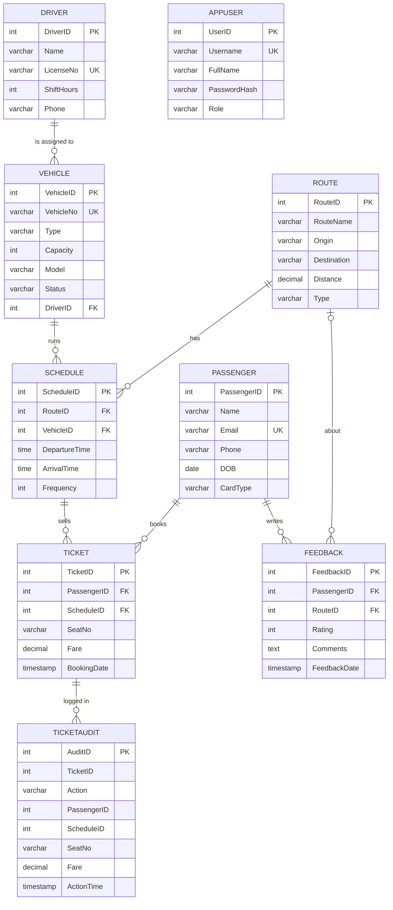

# RouteWise — Smart Public Transport Management System

A secure, role-based web application for managing urban transit: routes, schedules, fleet, drivers,
passengers, ticket booking and feedback. The MySQL database does the heavy lifting — constraints,
views, functions, stored procedures with transactions and a cursor, triggers, and least-privilege database
users — and Flask provides the interface.

## Tech stack
- **Frontend:** HTML5, Bootstrap 5, Bootstrap Icons, Chart.js
- **Backend:** Python 3, Flask, `mysql-connector-python`
- **Database:** MySQL 8+ (views, functions, procedures, triggers, CHECK constraints, indexes, privileges)

## Features
| Page | What it does |
|---|---|
| **Login** | Session login, salted password hashes, three roles (see below) |
| **Dashboard** | KPIs, revenue-by-route chart, busiest departures, recent bookings |
| **Bookings** | Book via `BookTicket` (fare auto-calculated by `CalcFare`), **transfer** a ticket via `TransferTicket` (one transaction), cancel via `CancelTicket`, live search, CSV export |
| **Passengers** | Add / edit / delete, trips and spend per passenger |
| **Fleet & Drivers** | Vehicles and drivers CRUD, vehicle status (Active / Maintenance / Retired) |
| **Routes & Schedules** | Routes and schedules CRUD, per-departure occupancy, no overlapping runs for one vehicle |
| **Feedback** | Ratings per route, average rating per route |
| **Reports** | 12 SQL reports — joins, GROUP BY/HAVING, subquery, anti-join, window functions, CTE, recursive CTE, a cursor procedure — with the query shown |
| **Users** *(admin)* | Create and remove application users |

### Roles
| Role | Can do |
|---|---|
| `viewer` | Read everything (dashboard, reports, lists). Can sign out. |
| `staff` | Everything a viewer can, plus bookings / transfers / cancellations, add & edit passengers, add feedback |
| `admin` | Everything, including fleet, routes, schedules, deletes and user management |

Permissions are enforced **on the server** for every request; hidden buttons are only a convenience.
Demo accounts are created automatically on first start: `admin / admin123`, `staff / staff123`,
`viewer / viewer123`. **Change these (Users page) before any real deployment.**

### Security
- Passwords hashed with Werkzeug (salted), never stored in plain text
- CSRF token required on every POST; HttpOnly + SameSite session cookies; private pages are not cached
- All SQL uses parameterised queries; templates auto-escape output; CSV export neutralises spreadsheet formulas
- **The application connects as a least-privilege database user (`routewise_app`), not root.** It cannot create,
  alter or drop anything, and it can only *read* the audit table — only the triggers write to it
- Debug mode off by default (`FLASK_DEBUG=1` to enable)

## Database design


### Database objects
| Type | Name | Purpose |
|---|---|---|
| Views | `BookingSummary`, `ScheduleOccupancy`, `RouteRevenue`, `RouteRatings`, `ActiveVehicle` | Dashboard and reporting; `ActiveVehicle` is updatable `WITH CHECK OPTION` |
| Functions | `SeatsLeft(schedule)`, `CalcFare(passenger, schedule)` | Remaining seats; fare = max(₹10, distance × rate) minus card discount (Daily 10 %, Weekly 20 %, Monthly 30 %) |
| Procedures | `BookTicket`, `CancelTicket`, `TransferTicket`, `RouteScorecard` | Booking and cancellation; **transfer as one all-or-nothing transaction** (`START TRANSACTION`, exit handler, `ROLLBACK`); **cursor** that scores and grades every route |
| Triggers | `PreventDoubleSeat`, `CheckCapacity`, `PreventVehicleOverlap`, `AuditBooking`, `AuditCancellation` | Reject taken seats / full or out-of-service vehicles / overlapping runs of one vehicle; write the audit trail. `PreventDoubleSeat` also locks the departure so simultaneous bookings queue instead of deadlocking |
| Constraints | `UNIQUE (ScheduleID, SeatNo)`, `CHECK` on fare, capacity, rating, times, status, card type, role | Integrity enforced inside the database |
| Indexes | `Ticket.PassengerID`, `Schedule.RouteID`, `Schedule.VehicleID`, `Feedback.RouteID`, plus the unique seat key | Faster joins — measured on 200,000 rows (see below) |
| Privileges | user `routewise_app` | Read/write business tables, **read-only audit table**, execute routines, nothing else |

## Normalisation: every relation is in BCNF
Each non-trivial functional dependency has a candidate key on its left side:

| Relation | Functional dependencies (candidate keys on the left) |
|---|---|
| Passenger | PassengerID → all; Email → all |
| Driver | DriverID → all; LicenseNo → all |
| Route | RouteID → all |
| Vehicle | VehicleID → all; VehicleNo → all |
| Schedule | ScheduleID → all; (VehicleID, DepartureTime) → all |
| Ticket | TicketID → all; (ScheduleID, SeatNo) → all |
| Feedback | FeedbackID → all |
| AppUser | UserID → all; Username → all |

`Ticket.Fare` is stored on purpose although `CalcFare` can compute it: the price paid must not change when the
fare rules change later. `TicketAudit` is a deliberate denormalised history log.

### Transactions, isolation and locking
- The default isolation level is REPEATABLE READ (InnoDB). Booking would still allow two sessions to read the same
  seat count; `PreventDoubleSeat` therefore starts with `SELECT … FOR UPDATE` on the departure row, so bookings for
  one departure are **serialised** while other departures proceed in parallel. 20 simultaneous bookings on a
  5-seat vehicle store exactly 5 tickets and answer the other 15 with “Vehicle is full” — no deadlocks.
- `TransferTicket` is a multi-statement transaction: if any step raises an error the handler issues `ROLLBACK`
  and re-raises, so a passenger never ends up with no ticket or with two.

## Setup
1. Start MySQL 8+, then import the schema as the MySQL admin (safe to re-run). It also creates the restricted
   application user `routewise_app`:
   ```bash
   mysql -u root -p < schema.sql
   ```
   (or open `schema.sql` in MySQL Workbench and run it)
2. Install dependencies:
   ```bash
   python3 -m venv .venv && source .venv/bin/activate
   pip install -r requirements.txt
   ```
3. Run and open <http://127.0.0.1:5000> (the app logs in to MySQL as `routewise_app` with the demo password from
   `schema.sql`; override with `DB_USER`, `DB_PASSWORD`, `DB_HOST`, `DB_NAME`, `SECRET_KEY` — and change that
   password in production):
   ```bash
   python app.py
   ```

`queries.sql` contains the 12 report queries so they can be run directly in MySQL Workbench.

## Operations
| Task | Command |
|---|---|
| Back up (data, views, routines, triggers) | `scripts/backup.sh [file]` → `backups/public_transport_<timestamp>.sql` |
| Restore into any database | `scripts/restore.sh file [target-database]` |
| Index benchmark on 200,000 tickets | `.venv/bin/python scripts/benchmark.py` → `benchmarks/results.json` |

Admin tools use `MYSQL_ADMIN_USER` / `MYSQL_ADMIN_PASSWORD` (default: `root`, empty password).

### Index benchmark (200,000 tickets, separate database)
Measured by `scripts/benchmark.py` (mean of 15 runs; numbers vary a little per machine):

| Query | With index | Without | Speed-up | Plan with → without |
|---|---|---|---|---|
| Passenger history `WHERE PassengerID = ?` | 0.2 ms | 18 ms | ≈ 90× | `ref` on `idx_ticket_passenger` → full scan `ALL` |
| Seat lookup `WHERE ScheduleID = ? AND SeatNo = ?` | 0.15 ms | 24 ms | ≈ 160× | `const` on `uq_schedule_seat` → `ALL` |
| Passenger spend per route (3-table join) | 0.3 ms | 23 ms | ≈ 78× | index nested-loop join → scan of the big table |

## Tests
46 end-to-end tests: authentication, roles, CSRF, booking rules, triggers, audit log, fare calculation, CRUD,
constraints, reports, **transactions and rollback, database privileges, the updatable view, window/CTE/cursor
reports, backup and restore round trip**, regression tests for concurrency / overlapping schedules / CSV safety /
validation, and a UI audit that presses every visible button as every role. They build throw-away databases from
`schema.sql` and drop them afterwards — your real data is never touched.
```bash
python -m unittest discover -s tests -v
```
(Set `MYSQL_ADMIN_USER` / `MYSQL_ADMIN_PASSWORD` if the admin account is not `root` with an empty password.)

## Project structure
```
app.py          Flask routes, auth, database helpers, report definitions
schema.sql      tables, constraints, indexes, views, functions, procedures, triggers, privileges, seed data
queries.sql     the 12 report queries, runnable in MySQL Workbench
scripts/        backup.sh, restore.sh, benchmark.py
benchmarks/     results.json (output of the last benchmark run)
tests/          automated test suite
templates/      Jinja2 pages (base layout + one template per page)
static/         style.css, app.js
```
