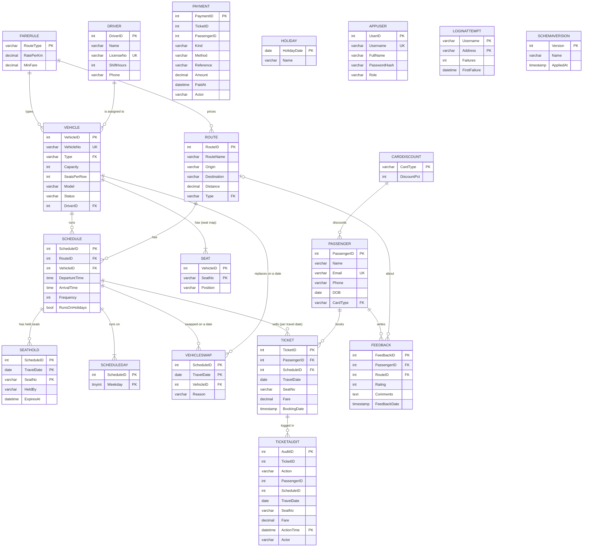

# RouteWise — Public Transport Management System

[](https://github.com/sarveshsuhaskute/RouteWise/actions/workflows/tests.yml)

A secure, role-based web application for running a city's buses and metro: routes, timetables with service days and
public holidays, fleet with a seat map per vehicle, drivers, passengers, seat-by-seat ticket booking and feedback.
The MySQL database does the heavy lifting — constraints, views, functions, stored procedures with transactions and a cursor,
thirty triggers (checking every insert, update and delete), seat holds that expire, one-day vehicle swaps, a payment ledger kept by triggers, three scheduled
events, a range-partitioned audit trail, FULLTEXT search, data-driven fares, versioned migrations, least-privilege database
users and a demonstrated primary/replica setup — and Flask provides the interface.

## Tech stack
- **Frontend:** HTML5, Bootstrap 5, Bootstrap Icons, Chart.js, a small vanilla-JS seat picker
- **Backend:** Python 3, Flask, `mysql-connector-python`, `waitress` (production-style server)
- **Database:** MySQL 8+ (views, functions, procedures, triggers, events, CHECK constraints, B-tree and FULLTEXT indexes, privileges, versioned schema)
- **CI:** GitHub Actions runs the whole test suite against a real MySQL server, builds and starts the Docker stack behind
  HTTPS, and runs an accessibility audit of every page, on every push
- **Deployment:** Docker image + `docker-compose.yml` (MySQL 8.4, the app, Caddy with automatic HTTPS)

## Features
| Page | What it does |
|---|---|
| **Login / My account** | Session login, salted password hashes, three roles, a sign-in attempt limit stored in the database, own-password change, a warning while a published demo password is in use |
| **Dashboard** | KPIs, departures running today, the next public holiday, departures now, revenue-by-route chart, busiest trips, recent bookings |
| **Bookings** | Record how the ticket was paid (cash, UPI or card, with a reference); pick a seat on the **seat map** of the chosen trip (window / aisle / middle, taken seats greyed out); clicking a seat **holds it for 5 minutes** so a colleague cannot sell it meanwhile; book via `BookTicket`, **transfer** to another departure, seat or day via `TransferTicket` in one transaction, cancel via `CancelTicket`, indexed search, pagination, CSV export |
| **E-tickets** | A printable e-ticket for every booking with a **signed QR code**; scanning it opens the ticket check, which says *valid today*, *valid for another day*, *expired*, *cancelled* (with who and when, from the audit trail) or *not genuine* |
| **Departure board** | Every departure running today with its status (Scheduled, Boarding, En route, Arrived, Cancelled) worked out from the timetable by the `DepartureBoard` view; refreshes every minute |
| **Passengers** | Add / edit / delete, trips and spend per passenger, FULLTEXT search by name or email, phone and number lookup |
| **Fleet & Drivers** | Vehicles (capacity and **seats per row**, which define the seat map) and drivers, vehicle status (Active / Maintenance / Retired) |
| **Routes & Schedules** | Routes, departures with their **service days** (e.g. Mon–Fri) and whether they run on public holidays, a **public-holiday calendar**, **one-day vehicle swaps** (another vehicle runs a trip, e.g. during a repair), occupancy today, editable fare rules and card discounts (admin) |
| **Feedback** | Ratings per route, average rating per route |
| **Reports** | 14 SQL reports (incl. a cash-up with `WITH ROLLUP`) — joins, GROUP BY/HAVING, subquery, anti-join, window functions, CTE, recursive CTE, a cursor procedure, a composite-key join into the seat map — each with its query shown; short lists and a 30-second cache keep them fast on large data |
| **Users** *(admin)* | Create and remove application users |

### Roles
| Role | Can do |
|---|---|
| `viewer` | Read everything (dashboard, reports, lists). Can sign out and change own password. |
| `staff` | Everything a viewer can, plus bookings / transfers / cancellations, add & edit passengers, add feedback |
| `admin` | Everything, including fleet, routes, schedules, holidays, fare rules, deletes and user management |

Permissions are enforced **on the server** for every request; hidden buttons are only a convenience.

### Accessibility
`tools/a11y_audit.js` runs axe-core with the WCAG 2.1 A and AA rules on all 26 pages, signed in as an administrator and as a
viewer; it reports no violations, and CI runs it on every push. Labels are tied to their fields, icon buttons have spoken
names, colours meet the 4.5:1 contrast ratio, wide tables can be scrolled with the keyboard, the seat map announces each
seat (number, position, free/taken) and the chosen one, there is a skip link, and the departure board's auto-refresh can be
switched off.

### Security
- Passwords hashed with Werkzeug (salted), never stored in plain text; minimum length 8; the published demo passwords cannot be chosen again
- **Five failed sign-ins lock a username/address pair for 10 minutes.** The count lives in the `LoginAttempt` table, so a
  restart does not reset it and every server process sees the same count; a MySQL **event** deletes day-old entries every hour
- Demo accounts (`admin / admin123`, `staff / staff123`, `viewer / viewer123`) exist only for a demonstration: the app shows a
  warning banner to anyone signed in with one of those passwords. With `DEMO_USERS=0` they are never created; create the
  first administrator with `python scripts/create_admin.py <username>` instead
- CSRF token required on every POST; HttpOnly + SameSite session cookies; private pages are not cached
- All SQL uses parameterised queries (search terms included: FULLTEXT operators typed by a user are stripped); templates auto-escape output; CSV export neutralises spreadsheet formulas
- **The application connects as a least-privilege database user (`routewise_app`), not root.** It cannot create, alter
  or drop anything; tickets it can only *read* — selling, cancelling and transferring run inside the stored procedures, so
  every ticket gets a travel date from today to 30 days ahead and a booking time set by MySQL;
  and it can only *read* the audit table, the payment ledger, the seat map and the seat holds — only triggers and the `HoldSeat`
  procedure write to those. The maintenance routines `GenerateSeats` and `ExtendAuditPartitions` run with the **caller's**
  rights (`SQL SECURITY INVOKER`), so the triggers and events can use them and the application cannot
- E-ticket QR codes carry an HMAC signature over the ticket's trip, seat and passenger, so a changed or made-up code is
  recognised; keep `SECRET_KEY` fixed in `.env`, or codes issued before a restart stop verifying
- The audit trail records **who** acted: the application tells MySQL the signed-in user for each connection
- The database password and `SECRET_KEY` live in a git-ignored `.env` file (`scripts/set_app_password.sh` changes the password); debug mode is off by default

## Database design

`HOLIDAY` is read by the `RunsOn` function rather than referenced by a key; `PAYMENT` and `TICKETAUDIT` are ledgers written by
triggers and keep no foreign keys (tickets are deleted when cancelled); `LOGINATTEMPT` and `SCHEMAVERSION` stand alone.

### Database objects
| Type | Name | Purpose |
|---|---|---|
| Tables | 19 (see the diagram) | Reference data (`FareRule`, `CardDiscount`, `Holiday`), transport data, the seat map (`Seat`), service days (`ScheduleDay`), one-day `VehicleSwap`s, `Ticket` per **trip** (schedule + travel date), `SeatHold`, the `Payment` ledger, `TicketAudit`, `AppUser`, `LoginAttempt`, `SchemaVersion` |
| Partitioning | `TicketAudit` by `RANGE COLUMNS (ActionTime)` on a DATETIME, one partition per quarter plus `pmax` | The history only grows: a query for one period reads only its partitions (`EXPLAIN` shows the pruning), and a quarter can be archived or dropped in one step. Possible because the table has no foreign keys; the primary key is `(AuditID, ActionTime)` because the partitioning column must belong to every unique key. A DATETIME with `RANGE COLUMNS` needs no conversion function, does not depend on the session time zone and has no 2038 limit (a TIMESTAMP and `UNIX_TIMESTAMP()` end in January 2038). Trip questions use the separate index `(ScheduleID, TravelDate)` |
| Views | `BookingSummary`, `ScheduleOccupancy` (today, incl. whether it runs today), `TripOccupancy` (any date), `RouteRevenue`, `RouteRatings`, `ActiveVehicle`, `DepartureBoard` | Dashboard, departure board and reporting; `ActiveVehicle` is updatable `WITH CHECK OPTION` |
| Functions | `TripVehicle(schedule, date)`, `SeatsLeft(schedule, date)`, `CalcFare(passenger, schedule)`, `RunsOn(schedule, date)` | The vehicle a trip really uses (a one-day swap or the scheduled one); free seats of a trip; fare = max(MinFare, distance × RatePerKm) minus the card discount, **read from tables**; whether a departure runs on a date (service days and holidays) |
| Procedures | `BookTicket`, `CancelTicket`, `TransferTicket`, `HoldSeat`, `AddSchedule`, `RouteScorecard`, `GenerateSeats`, `ExtendAuditPartitions` | Booking with date rules (not in the past, at most 30 days ahead); **transfer as one all-or-nothing transaction** (`START TRANSACTION`, exit handler, `ROLLBACK`); **seat holds** under the same row lock as bookings; a **cursor** that scores and grades every route; seat-map generation with a recursive CTE; partition maintenance with dynamic DDL (`REORGANIZE PARTITION`) |
| Triggers (30) | `PreventDoubleSeat` → `CheckServiceDay` → `CheckCapacity` → `ValidateSeat` on Ticket (ordered with `FOLLOWS`); `AuditBooking` → `ReleaseHold` → `RecordSale`, `AuditCancellation` → `RecordRefund`; `PreventVehicleOverlap`, `CheckVehicleRouteType`, `DefaultServiceDays` on Schedule; `GuardServiceDay` on ScheduleDay; `CheckVehicleSwap`, `CheckSwapRemoval` on VehicleSwap; `CreateSeats`, `ResizeSeats` on Vehicle; **update rules:** `ProtectTicket`, `CheckScheduleChange`, `CheckVehicleChange`, `CheckRouteChange`, `CheckHoliday`, `CheckHolidayChange`, `ProtectSeat`, `ProtectServiceDay`, `ProtectSwap`; **append-only ledgers:** `ProtectPaymentUpdate`/`Delete`, `ProtectAuditUpdate`/`Delete` | Reject a taken seat or one held by another clerk, a day the departure does not run, a full or out-of-service vehicle, a seat the vehicle does not have, overlapping runs, a vehicle on a route of the wrong type; write the audit trail with the actor; post a sale and a refund to the payment ledger; release a hold once its seat is booked; give a new departure every day and keep at least one; let a swap through only if the replacement is active, of the right type, free at that time and has every seat already sold; keep the seat map in step with the vehicle and refuse a change that would remove a seat booked for an upcoming trip; **check every UPDATE as strictly as an INSERT** — a sold ticket is never edited (it is cancelled or transferred, so the ledger and the audit trail stay true), a departure that changes vehicle, times or route passes the overlap and type checks and keeps every sold seat, a vehicle that runs departures keeps its type and leaves service only when nobody is booked on a trip it would still run, a route with departures keeps its type, a public holiday (or switching off `RunsOnHolidays`) cannot strand sold tickets, seat labels, service days and swaps are not rewritten; the payment ledger and the audit trail refuse UPDATE and DELETE **for every account, root included** (a mistake is corrected by a new entry; old audit quarters are archived with `DROP PARTITION`) |
| Events (3) | `PurgeLoginAttempts` (hourly), `PurgeSeatHolds` (every minute), `MaintainAuditPartitions` (monthly) | Housekeeping inside MySQL: old sign-in failures, expired seat holds, and at least six months of future audit partitions |
| Constraints | 20 `CHECK` (fare, seat label, travel-date window, capacity, seats per row, seat position, weekday, payment kind/method/sign, rating, times, status, role ...), 15 foreign keys, `UNIQUE (ScheduleID, TravelDate, SeatNo)` | Integrity enforced inside the database |
| Indexes | B-tree: `Ticket.PassengerID`, `Ticket.TravelDate`, `Schedule.RouteID`, `Schedule.VehicleID`, `Feedback.RouteID`, `Passenger.Phone`, the unique trip-seat key; **FULLTEXT:** `Passenger(Name, Email)`, `Route(RouteName, Origin, Destination)` | Faster joins and search — measured on 200,000 rows (see below) |
| Privileges | user `routewise_app` | Read/write business tables (tickets: read only — written by the procedures), update fare rules, manage holidays, service days and swaps, **read-only audit trail, payment ledger, seat map and seat holds**, execute routines (invoker-rights maintenance routines excepted), nothing else |

### Normalisation: every relation is in BCNF
Each non-trivial functional dependency has a candidate key on its left side:

| Relation | Functional dependencies (candidate keys on the left) |
|---|---|
| FareRule | RouteType → all |
| CardDiscount | CardType → all |
| Passenger | PassengerID → all; Email → all |
| Driver | DriverID → all; LicenseNo → all |
| Route | RouteID → all |
| Vehicle | VehicleID → all; VehicleNo → all |
| Seat | (VehicleID, SeatNo) → Position (window/aisle depends on the vehicle's layout, so the whole key is needed) |
| Schedule | ScheduleID → all; (VehicleID, DepartureTime) → all |
| Holiday | HolidayDate → Name |
| Ticket | TicketID → all; (ScheduleID, TravelDate, SeatNo) → all |
| SeatHold | (ScheduleID, TravelDate, SeatNo) → HeldBy, ExpiresAt |
| ScheduleDay | all-key (ScheduleID, Weekday): no non-trivial dependency — the textbook 1NF form of “runs on these days” |
| VehicleSwap | (ScheduleID, TravelDate) → VehicleID, Reason |
| Payment | PaymentID → all |
| Feedback | FeedbackID → all |
| AppUser | UserID → all; Username → all |
| LoginAttempt | (Username, Address) → all |

The link from a ticket to its seat is checked by the `ValidateSeat` trigger, not a foreign key: a foreign key to
`Seat (VehicleID, SeatNo)` would need a `VehicleID` column in `Ticket`, but `ScheduleID → VehicleID`, so that column would
break BCNF (and be wrong on a day with a vehicle swap). Two deliberate exceptions, both maintained by the database itself: `Ticket.Fare` is stored although `CalcFare` can compute it
(the price paid must not change when the fare rules change later), and the `Seat` rows follow from `Vehicle.Capacity` and
`SeatsPerRow` (the triggers rebuild them on every change, and a seat needs a row of its own so a ticket can be checked against
it and the report can join on it). Row and column are not stored separately in `Seat`: they are part of the label (`7C`),
which would otherwise break BCNF. `TicketAudit` is a history log.

### Transactions, isolation and locking
- The default isolation level is REPEATABLE READ (InnoDB). `scripts/isolation_demo.py` shows what each level does with
  two real sessions: READ COMMITTED lets a re-read change (10 then 200) and lets a phantom row appear, REPEATABLE READ keeps a
  stable snapshot; a read-then-write update **loses** one of two concurrent updates (11 instead of 12), while
  `SELECT … FOR UPDATE` or a single `UPDATE x = x + 1` gets it right.
- `PreventDoubleSeat` starts with `SELECT … FOR UPDATE` on the departure row: bookings for one departure are **serialised**
  while other departures proceed in parallel. Twenty sessions fighting for the five seats of one vehicle store exactly five
  tickets, and the other fifteen get "Seat already booked" or "Vehicle is full" — never a deadlock or an oversold trip.
- `TransferTicket` is a multi-statement transaction: if any step raises an error the handler issues `ROLLBACK`
  and re-raises, so a passenger never ends up with no ticket or with two. Twelve transfers in opposite directions at the same
  moment lose and duplicate nothing (tested).
- `HoldSeat` takes the same departure lock as a booking, so a hold and a booking for one departure never interleave: a seat can be
  held by one clerk at a time, booked only by its holder until the hold expires, and the hold disappears with the booking.
- `AddSchedule` inserts a departure and narrows its service days in one transaction; a vehicle swap takes the departure
  lock too, so no seat is sold on a trip while its vehicle changes.
- The sign-in limit uses a single `INSERT … ON DUPLICATE KEY UPDATE`, so two failed attempts at the same moment cannot overwrite each other's count.

## Setup
1. Start MySQL 8+, then import the schema as the MySQL admin (safe to re-run). It also creates the restricted
   application user `routewise_app`:
   ```bash
   mysql -u root -p < schema.sql
   ```
   (or open `schema.sql` in MySQL Workbench and run it). **Upgrading an older database instead?** Use the migration runner
   below — it keeps your data.
2. Install dependencies:
   ```bash
   python3 -m venv .venv && source .venv/bin/activate
   pip install -r requirements.txt
   ```
3. Run and open <http://127.0.0.1:5000> — the production-style server:
   ```bash
   python -m waitress --listen=127.0.0.1:5000 app:app
   ```
   or the development server (auto-reload with `FLASK_DEBUG=1`): `python app.py`.
   On macOS use `127.0.0.1`, not `localhost`: AirPlay Receiver also listens on port 5000.
   Settings come from the environment or a git-ignored `.env` file (see `.env.example`): `DB_USER`, `DB_PASSWORD`,
   `DB_HOST`, `DB_NAME`, `SECRET_KEY` (keeps people signed in across restarts), `DEMO_USERS`, `REPORT_CACHE_SECONDS`.
4. Before any real use: replace the database password and do not use the demo accounts.
   ```bash
   scripts/set_app_password.sh 'a-long-new-password'
   ```

`queries.sql` contains the 14 report queries so they can be run directly in MySQL Workbench.

### With Docker (any machine, HTTPS)
```bash
cp .env.example .env      # then set MYSQL_ROOT_PASSWORD, APP_DB_PASSWORD and SECRET_KEY in .env
docker compose up -d --build
```
Open <https://localhost:8443>. Caddy serves HTTPS with its own local certificate (your browser asks you to trust it); set
`SITE_ADDRESS` to a real domain name and it obtains a Let's Encrypt certificate instead. The database volume is initialised
from `schema.sql` on the first start, and `/healthz` reports whether the app can reach the database.

### Monitoring
Every request writes one access-log line (method, path without the query string, status, duration, user) to stderr, where
waitress and `docker compose logs` collect it. Set `METRICS_TOKEN` and `/metrics` serves Prometheus metrics to a scraper that
sends `Authorization: Bearer <token>`: requests and latency histograms per page and status, tickets sold today, seats held
and the schema version. Without the token the endpoint answers 404.

## Operations
| Task | Command |
|---|---|
| Upgrade an existing database to the latest schema (backup first, data kept) | `python scripts/migrate.py` (`--status` to look only) |
| Back up (data, views, routines, triggers, events) | `scripts/backup.sh [file]` → `backups/public_transport_<timestamp>.sql` |
| Restore into any database | `scripts/restore.sh file [target-database]` |
| Load a large demo data set (≈ 3,000 passengers, 25,000 tickets) | `python scripts/load_sample_data.py` (safe to re-run; `--scale 0.1` for a smaller set) |
| Index benchmark on 200,000 rows | `python scripts/benchmark.py` → `benchmarks/results.json` |
| Time every report (use on large data) | `DB_NAME=… python scripts/report_timings.py` |
| See isolation levels and locking in action | `python scripts/isolation_demo.py` |
| See primary/replica replication and a failover (two private servers) | `python scripts/replication_demo.py` |
| Run the accessibility audit | `npm install --prefix tools axe-core@4.10 puppeteer-core@23 && node tools/a11y_audit.js http://127.0.0.1:5000` |
| Create or reset an administrator | `python scripts/create_admin.py <username> ["Full name"]` |
| Change the application's database password | `scripts/set_app_password.sh 'new-password'` |

Admin tools use `MYSQL_ADMIN_USER` / `MYSQL_ADMIN_PASSWORD` (default: `root`, empty password).

### Schema versions and migrations
A database records its version in `SchemaVersion`. `schema.sql` is always the latest version (a fresh install); files in
`migrations/` upgrade older databases step by step, and a released migration never changes (its generator refuses to run
again). `0003` added the seat map — existing tickets were relabelled to seats of it, the k-th ticket of a trip getting the
k-th seat — and `0004` (generated by `migrations/make_0004.py`) adds seat holds and turns the audit table into a partitioned
table. The structural part of each is hand-written; the new tables, indexes, functions, views, procedures, triggers, events
and grants are copied verbatim from `schema.sql`. `0005` turns the service-day SET column into `ScheduleDay` rows, opens the payment ledger with one cash sale per existing
ticket and re-partitions the audit trail on a DATETIME. `0006` adds the update rules and the append-only ledgers and
takes back the application's UPDATE/DELETE rights on tickets (`REVOKE IF EXISTS`); `0007` takes back its INSERT on tickets
too and adds the route-type, holiday and vehicle-retirement rules. A test upgrades a version-1 database
through versions 2 to 7 and compares **354 schema facts** (columns, indexes, checks, foreign keys, triggers, routines and
their security mode, events, partitions, views and the application user's privileges) with a fresh install — they are identical, no ticket or fare is lost and every ticket names a real seat.

### Large sample data and pagination
`schema.sql` seeds a small, readable demo (13 passengers, 24 tickets for today, 12 departures including a weekday-only and
a weekend-only one). To see the system at a realistic size, run the loader:

```bash
python scripts/load_sample_data.py
```

It adds 30 routes, 66 vehicles and drivers, about 600 departures (about one in eight runs Monday to Friday only), about 3,000
passengers, about 25,000 tickets (each departure on two different days of the last month) and about 1,500 feedback entries in
a few seconds. Every row except the tickets goes through the application's own database user; the tickets are history (the
last 30 days), which the application may never create, so they are imported with the MySQL admin account
(`MYSQL_ADMIN_USER` / `MYSQL_ADMIN_PASSWORD`). Every row passes the same constraints and triggers as real use: only seats of the vehicle's seat map, no overbooked trip, no duplicate seat, no overlapping run, no trip on a day the
departure does not run, and every ticket has an audit row. Running it twice does nothing.

Long lists would be unusable at that size, so the application searches and pages on the server. Measured on the loaded data
(about 25,000 tickets, 3,000 passengers):

| Page | Rows | Time |
|---|---|---|
| Bookings, first page of 24,811 | 50 shown | ≈ 90 ms |
| Bookings, search "Kumar" (FULLTEXT on passengers and routes) | 1,050 found | ≈ 65 ms |
| Passengers, search "Kumar" | 127 found | ≈ 19 ms |
| Seat map of one trip (`/api/seats`, with holds) | 60 seats | ≈ 10 ms |
| Reports (13 queries) | 1 page | ≈ 390 ms first view, ≈ 2 ms cached |

### Index benchmark (200,000 rows, separate database)
Measured by `scripts/benchmark.py` (mean of 15 runs; numbers vary a little per machine):

| Query | With index | Without | Speed-up | Plan with → without |
|---|---|---|---|---|
| Passenger history `WHERE PassengerID = ?` | 0.12 ms | 21.9 ms | ≈ 183× | `ref` on `idx_ticket_passenger` → full scan `ALL` |
| Seat lookup `WHERE ScheduleID = ? AND TravelDate = ? AND SeatNo = ?` | 0.07 ms | 4.0 ms | ≈ 57× | `const` on `uq_trip_seat` → falls back to the date index |
| Passenger spend per route (3-table join) | 0.17 ms | 18.8 ms | ≈ 110× | index nested-loop join → scan of the big table |
| Name search: `MATCH … AGAINST` vs `LIKE '%word%'` | 0.16 ms | 41.2 ms | ≈ 257× | `fulltext` on `ft_passenger` → full scan `ALL` |

## Tests
122 end-to-end tests in eight modules, run on every push by GitHub Actions after a `ruff` lint: **update rules** (tickets only through the procedures and never edited, route types, holidays and vehicle retirement guarded, departure and vehicle
changes checked, ledger and audit trail append-only even for root), **vehicle swaps** (the replacement's seat map, every refusal
rule, removal), **the payment ledger** (sale, refund, transfer, balance, validation, the ROLLUP report), **service-day rows**
(daily by default, atomic AddSchedule, sold days kept), **replication** (two private servers, rows and trigger output arrive,
writes refused on the replica, failover to the promoted replica with nothing lost), authentication, roles, CSRF, **the seat map** (generation, layout,
validation, resizing that never drops a booked seat), **seat holds** (blocking colleagues, one per clerk, expiry, release on
booking), **e-tickets and their verification** (valid, future, tampered, cancelled, transferred), **partitioning** (layout,
pruning, automatic extension), the departure board, **service days and public holidays**, **FULLTEXT search and its query
plans**, trips and travel dates, fare rules, type checks, who-acted audit, booking rules, triggers, fare calculation, CRUD,
constraints, reports, **transactions and rollback, concurrent bookings and transfers, isolation levels, database privileges,
the updatable view, window/CTE/cursor reports, the scheduled event, backup and restore round trip, schema migration
equivalence**, account security (password change, stored sign-in limit, demo-password warning), the production server, the
large-data loader with search and pagination, **monitoring** (access log, `/metrics` token, counters), regression tests, and a UI audit that presses every visible button as every
role. They build throw-away databases from `schema.sql` and drop them afterwards — your real data is never touched.
```bash
python -m unittest discover -s tests -v
pip install -r requirements-dev.txt && ruff check .      # the lint CI runs
```
Each module (`test_accounts`, `test_booking`, `test_concurrency`, `test_network`, `test_operations`, `test_reports`,
`test_rules`, `test_ui`) builds its own fresh database, so no module depends on another; `tests/support.py` holds the shared
helpers. (Set `MYSQL_ADMIN_USER` / `MYSQL_ADMIN_PASSWORD` if the admin account is not `root` with an empty password.)

## Project structure
```
app.py              entry point (python app.py, or waitress app:app)
routewise/          the application package
  __init__.py       creates the Flask app and its settings
  db.py             connection settings, query helpers, readable database errors
  auth.py           sign-in, roles, CSRF, sign-in limit, own password, users
  search.py         turns search-box input into FULLTEXT / prefix conditions
  web.py            shared request helpers, template filters, error pages
  monitoring.py     access log and the /metrics endpoint
  views/            one module per page: dashboard, bookings (incl. seat holds and payments), tickets (e-tickets, ticket check,
                    departure board), passengers, fleet, network (routes, schedules, holidays, fares), feedback, reports
  templates/        Jinja2 pages;  static/  style.css, app.js (seat picker), favicon
schema.sql          the latest schema: tables, constraints, indexes, functions, views, procedures, triggers, event, privileges, seed data
migrations/         upgrade scripts for older databases, the generator of the latest one, the version-1 baseline
queries.sql         the 14 report queries, runnable in MySQL Workbench
scripts/            migrate, backup, restore, load_sample_data, benchmark, report_timings, isolation_demo, replication_demo,
                    create_admin, set_app_password
tools/              a11y_audit.js (accessibility audit)
Dockerfile, docker-compose.yml, deploy/   container image; MySQL + app + Caddy (HTTPS); first-start database import
benchmarks/         results.json (output of the last benchmark run)
tests/              automated test suite (8 modules + support.py);  .github/workflows/  CI (lint, tests, Docker, accessibility)
ruff.toml, requirements-dev.txt   lint settings and development tools
```

## Known limits
- No live vehicle positions (GPS) and no passenger-facing app: these need outside services. The departure board is worked out from the timetable.
- Replication is demonstrated (`scripts/replication_demo.py`) and the app can read reports from a replica (`DB_REPLICA_HOST`),
  and the demo performs a manual failover (the replica is promoted and takes bookings with every earlier ticket intact),
  but nothing detects a failed primary automatically (MySQL InnoDB Cluster / Group Replication would). Only the audit table is partitioned: InnoDB partitioning does not support foreign keys,
  which every other large table relies on.
- Payments are recorded (method and reference), not taken: there is no card or UPI gateway.
